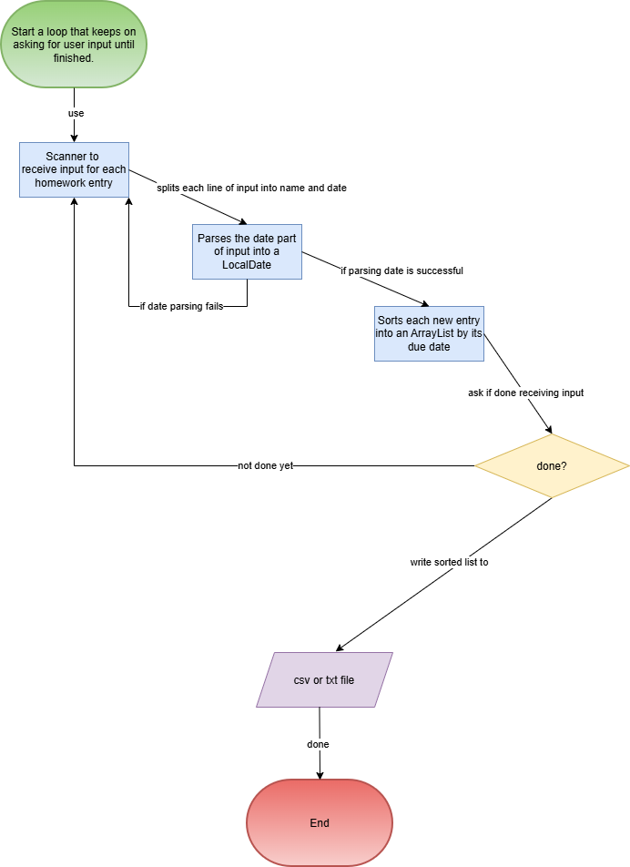

# Homework Sorter

Sorts homework by deadlines

## The Problem

My homework is scattered across different websites and platforms (Ed, Pearson, Brightspace), 
so it is very tedious and time-consuming to keep track of it all at once. 
Jumping across websites to find each homework assignment, completely rewriting my homework list, 
and then sorting my list for deadlines and due dates has been a source of frustration for me.

## How It Works

First, the program runs a loop for receiving input so that, as long as the program is not 
done receiving input, the program will continue to receive input (using imported Scanner) 
for each homework entry. Each entry of input is added to an ArrayList (ArrayList will be 
imported). As each entry is added, it will be sorted into its proper place by its deadline 
(custom-made method that puts more imminent deadlines above and later deadlines below) (also, 
sorting by deadline dates required importing from java.time library). Once the loop has ended 
(program is done receiving input), the sorted list will be written into a csv file (using a 
custom-made file-writer method). 
End of program.
note: there are print statements used to make the program more user-friendly



](https://github.com/WonshinKim/Homework-Sorter/blob/main/HomeworkSorter%20Diagram.drawio.png)

## Tech Stack

- **Language:** Java
- **Libraries:** java.util.Scanner, java.util.ArrayList, java.time.LocalDate, java.time.format.DateTimeParseException, java.io.PrintWriter, java.io.FileOutputStream, java.io.IOException
- **External tools:** none that I know of

## Setup

Step-by-step: how does someone who just cloned your repo get it
running?

```bash
git clone https://github.com/WonshinKim/Homework-Sorter
cd Homework-Sorter
cd src
javac HomeworkSorter.java
```

## Usage

How to actually run the thing, with examples.

```bash
java HomeworkSorter.java

example run:

Welcome to Homework Sorter!
Enter a homework title (no spaces in title), a space, and a due date with format yyyy-mm-dd
Example: 'EnglishEssay 2026-03-30'
(or enter 'done' when you are done entering homework entries)

(input from keyboard) EnglishEssay 2026-12-16

date conversion is a success!
homework title: EnglishEssay
date: 2026-12-16

arraylist:
EnglishEssay 2026-12-16

(again asks for input)

(input) Essay2027-01-01

make sure that there is a homework title and a date separated by a single space

(asks for input)

(input) (just an empty space is entered)

please do not enter an empty line, type 'done' when you are done

(asks for input)

(input) MathHomework1  2027-02-09 (two spaces instead of one)

invalid input format (use a title with no spaces, a single space, and a date with a yyyy-mm-dd format { ex. MathHomework1 2027-01-01} )

(asks for input)

Project1 2027-01-01

(shows success)

arraylist:
EnglishEssay 2026-12-16
Project1 2027-01-01

(asks for input)

MathHomework1 2026-12-20

(shows success)

arraylist:
EnglishEssay 2026-12-16
MathHomework1 2026-12-20
Project1 2027-01-01

(asks for input) 

(input) done

Your homework entries are in file: HomeworkList.csv

Thank you for using Homework Sorter!
(program ends)

(now do this to see the file:)
vim HomeworkList.csv

(the file should show this:)
EnglishEssay 2026-12-16
MathHomework1 2026-12-20
Project1 2027-01-01
```

## Roadmap

Features you haven't built yet but plan to (pull these from your
"Schedule" quadrant in the Eisenhower Matrix).

- [ ] List importance level of each homework next to each entry
- [ ] Rewrite csv or txt file when changes are made
- [ ] Enable MVP to clear out completed homework when asked to
- [ ] Receive individual new entries for new homework assignments
- [ ] Print entire contents of list when prompted


## Author

Wonshin Kim, https://github.com/WonshinKim.
